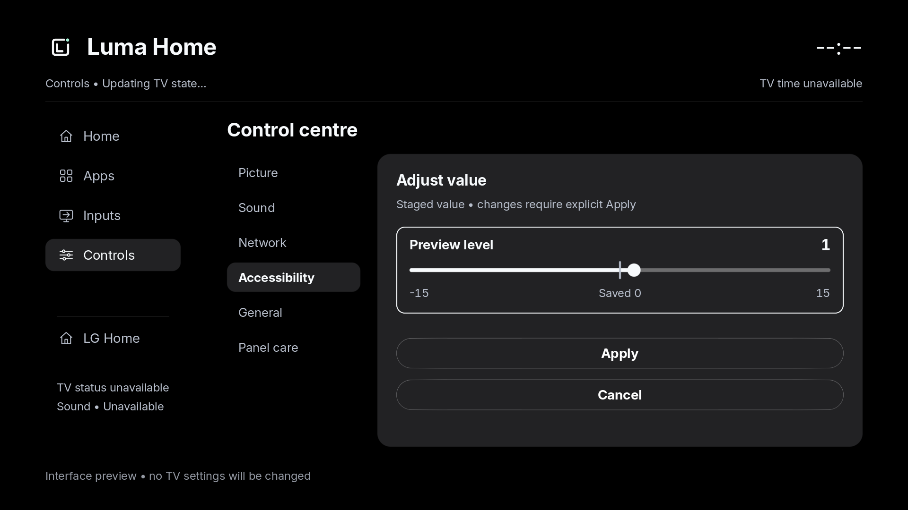

# Luma Home

An experimental native home dashboard for LG webOS TVs. This standalone project
owns the dashboard's app catalogue, favourites, navigation composition, TV
adapters, controls, persistence, branding and tests.

This is the independent [Luma Home repository](https://github.com/luma-home-tv/native-home).
The earlier combined prototype is preserved in
[native-home-prototype-history](https://github.com/luma-home-tv/native-home-prototype-history)
as an attributed PlxNative fork. It is historical reference; development continues here.

## PlxNative framework dependency

Luma Home builds on the research and engineering of
[PlxNative](https://github.com/GLinnik21/plx-native), by Gleb Linnik and its
contributors. Their rendering/UI/input framework remains explicitly named and
attributed as PlxNative. It is fetched into an ignored external checkout, pinned
by [dependency-lock.json](dependency-lock.json), rather than copied into Luma
Home's tracked application source.

The application consumes `plx_ui`, `plx_gfx`, `plx_machine`, `plx_base` and
`plx_platform`. It does not depend on PlxNative's Plex client, player, media,
session, data or application-screen crates. A separately identified
[integration patch](patches/plxnative-framework-integration.patch) adds local
texture artwork, an opt-in OLED-black surface role and bounded-grid whole-tile
admission shared by painting and pointer stops, plus a shared staged numeric
range widget, clipped native text-entry widget and grapheme-aware bounded text
buffer. These generic changes are
candidates for upstream contribution; their presence does not turn the upstream
framework into Luma Home-authored code.

The patch also provides a read-only form binding that blocks activation without
dimming a valid current value. Unavailable and inactive rows retain dim styling.
An opt-in bounded image decoder checks dimensions and per-image pixel-buffer
sizes before decoding; existing decoder defaults remain unchanged. Codec memory
limits are additional safeguards, not a total-heap or OOM guarantee.

The current upstream build scripts also need their SVG rasterizer, vector-icon
assets, locale catalogue and install-identity generator. The external checkout
keeps that support material intact. Its full repository cache contains upstream
application files, but those files are neither tracked here nor application
dependencies. A future upstream framework release could remove this checkout
and build-script coupling.

The [text-input milestone](docs/text-input-milestone.json) records isolated G2
system-keyboard typing/lifecycle work and the single-keyboard design. The retained
G2 preview now includes that integration; C2 retains its earlier keypad. The
[backed-up G2 update](docs/preview-update-milestone.json) records normal-build
Apps/Search/LG-keyboard/Back verification and preserved favourites.
The newer [shared-controller record](docs/keyboard-integration-milestone.json)
adds independent G2/C2 isolated flow, preedit and long-query evidence. See the
[parallel-development plan](docs/parallel-development.md),
[controls coverage audit](docs/controls-coverage-next.md) and
[webOS24 text compatibility notes](docs/webos24-text-compatibility.md).
Version 0.28.0 includes clearer native/read-only/LG-managed control-row
descriptions with existing action admission preserved. Its
[synthetic host previews](docs/verification/control-row-presentation/README.md)
and [isolated G2 Sound/Accessibility qualification](docs/control-row-presentation-milestone.json)
remain separate evidence. The [0.28 G2 delivery](docs/apps-scroll-rest-milestone.json)
also fixes a reproduced Apps scroll redraw tail, profiles the new build and
verifies the backed-up normal update with favourites preserved.
The [latest backed-up G2 delivery](docs/retained-preview-037.md) is 0.37.0:
app icons retain their own shape and alpha directly on black, with initials only
for missing artwork. Two normal sessions verified Apps/Search/keyboard, read-only
General/Inputs, a bounded black idle/wake and relaunch, with favourites and checked
LG state preserved. Physical input, all-app live artwork and broader release
checks remain separate. The earlier [0.31 delivery](docs/retained-preview-031-milestone.json)
introduced legible protected readings with activation still blocked. C2 was not
contacted for the 0.37 delivery.
The [build-input record](docs/build-inputs.md) documents a subsequently discovered
formatting drift in 0.29/0.30 dependency inputs and the new verification guards.
The frozen runtime evidence remains scoped to its actual executable hashes.
Version 0.31.0 adds [legible current read-only values](docs/verification/read-only-values/README.md)
with activation still blocked and unavailable/inactive styling preserved.
Its [isolated G2 qualification](docs/read-only-values-031-milestone.json) verifies
focused native text contrast and clean removal; its subsequent normal G2 delivery
is recorded separately above.
The [0.32 passive artwork-access survey](docs/artwork-access-032.md) adds a bounded
reader and decoder groundwork. One developer-app sample was readable; four other
locations were absent in the ordinary jail. Full live artwork remains unfinished,
At that survey, normal G2 remained on 0.31.0.
The [0.33 Identify-only candidate](docs/artwork-broker-identify.md) adds a separate
temporary native helper and restricted caller-binding proof. Host checks pass;
the isolated G2 app/helper were cleanly removed with checked state preserved.
The helper's anonymous bus registration was refused; the cross-jail exchange
and privileged artwork operations remain unqualified.
The [0.34 fixed context reader](docs/broker-context-reader-034.md) addresses that
registration boundary using three pinned system-client GETs. One native G2
Identify exchange and complete isolated cleanup/state checks pass.
The [0.35 isolated artwork transfer](docs/artwork-transfer-035.md) then qualified
five real icon transfers and ordinary-process decodes, one per observed
installation class, with clean removal and preserved checked state. Bounded cache
state is implemented. The [0.36 isolated C2 lifecycle](docs/artwork-live-036.md)
then verified an owned fixture through ordinary I/O, worker decode/cache, GL
refresh and removal, with clean shutdown and preservation. A direct RGB recheck
confirms every pixel outside the fixture icon stayed unchanged; the initial
missing-text report was incorrect and is corrected in that record. Production
helper startup and all-app live artwork delivery remain unfinished. The
[0.38 read-only native capability check](docs/artwork-startup-capability-038.md)
received HBC's bare true response from the ordinary G2 app and passed complete
isolated removal/preservation checks; it did not launch a broker. G2 now
retains 0.37.0 after its separate normal workflow; C2 was last verified on 0.20.0.
The [historical G2 timing/resource profile](docs/current-performance-milestone.json)
measures the frozen 0.26.0 isolated dashboard, including real idle/wake and
preserved state. It records continuing Apps repaints and is separate from
physical latency, normal-identity total cost or a matched speedup comparison.

The [app icon presentation](docs/icon-presentation.md) records the current
icon-only styling, missing-art fallback and its verification boundary.

## Layout

| Path | Ownership and purpose |
| --- | --- |
| `src/` | Luma Home application, models, adapters and tests |
| `docs/`, `design.json` | Plans, synthetic concepts and scoped proof records |
| `assets/luma-home/` | Independent imagegen-derived branding and vector masters |
| `resources/fonts/` | Third-party OFL Inter font resources and licence |
| `patches/` | Explicit modifications to the externally attributed framework |
| `.dependencies/plx-native/` | Ignored upstream dependency checkout |

## Development

Run `python3 prepare-framework.py`, then `python3 build-client.py test`.
`python3 tools/verify-framework.py .` performs a read-only input check.
The build wrapper checks those inputs before and after compilation; packaging
requires its matching adjacent build receipt. See [build inputs](docs/build-inputs.md).
`build-client.py host --bin home-preview` builds the desktop renderer.
The ARM path uses the LG SDK through `NATIVE_HOME_WEBOS_SDK` and a separate
`NATIVE_HOME_BUILD_DIR`. An explicit `--bin artwork-broker-proof` builds the
separate operator-started Identify test helper; application packaging rejects it.
Packaging includes
the Luma client, fonts, its own icon and explicitly supplied development assets.
No Plex application package, server sign-in or playback feature is built.

`NATIVE_HOME_INTERACTIVE_SESSION=1` selects the installable interactive preview
when packaging `home-preview`. It opens directly on Home, runs while foreground,
and exits on Back from Home or after losing foreground. The ordinary proof build
keeps its scripted capture sequence and 30-second bound. Interactive packages
reject scripted action probes. Their canvas blanks to opaque black after two
minutes without app input; the first input wakes it without activating a hidden
card. This is app-local idle behaviour, not a replacement for LG's OLED protections.
Normal packages make no household screenshots; session capture requires a
separate, explicit development proof flag. Host interactive mode uses `--session`.
The [interactive preview guide](docs/interactive-preview.md) describes navigation,
package modes and removal. Version 0.37.0 is installed on the OLED55G26LA G2;
the OLED65C26LD C2 was last verified on 0.20.0. The [branding/status milestone](docs/branding-status-milestone.json)
records native branding and live sound/network reads. The
[Controls layout milestone](docs/controls-layout-milestone.json) records the
category/detail composition, native navigation, G2 Settings-return regression
and 0.12.0 updates with favourites preserved. The
[LG-managed sections milestone](docs/settings-sections-milestone.json) adds
verified Picture, Sound, Accessibility, General and OLED Care routes on both
TVs, plus a focused Network entry in LG General. Earlier native idle/wake and owned-app launch
checks are recorded in the [deployment milestone](docs/deployment-milestone.json).

The [actual-main-loop milestone](docs/main-loop-milestone.json) records newer
isolated 0.24.0 keyboard/fallback, real idle/wake and programmatic departure
scenarios independently on both models. These use network navigation and
explicit synthetic text. The newer [OK-wake record](docs/ok-wake-milestone.json)
qualifies first-OK suppression and a distinct second-OK action on both models.
The [G2 human check](docs/manual-keyboard-milestone.json) confirms `lu` + Done,
reopen, then `ma` + Back retains `luma` with no second keypad. Its native trace
also records one safely drained same-batch closing-key release. Broader dismissal
races, C2 physical typing, performance and C2 promotion remain separate
acceptance gates. The G2 normal update is recorded separately from the earlier
human check. One G2 attempt exited on early focus loss before readiness;
cold-entry reliability remains under investigation. The
[G2 startup/relaunch record](docs/startup-relaunch-milestone.json) now adds two
planned 0.26.0 sessions: programmatic LG Home departure with the keyboard open,
then a new process from the same preserved installation and saved preferences.
Both passed and were removed. This bounded observation does not explain the
earlier focus loss or establish general cold-entry reliability. The
[parallel delivery plan](docs/parallel-development.md) assigns implementation,
independent review and per-TV validation without concurrent device ownership.
The [guidance-read milestone](docs/guidance-read-milestone.json) adds isolated
ordinary-app and native focus/scroll proof for guidance volume, pitch and speed
on both TVs. These are read-only choices; retained previews are unchanged.
The next [optional Sound read group](docs/sound-read-design.md) is integrated
and has [independent 0.26.0 native qualification](docs/sound-read-milestone.json)
on both TVs. Balance, description enablement and description level are read-only;
their ordinary-app wire values/schemas, focus/scroll and removal are verified.
Native freshness transitions, audible effects and retained promotion remain open.

The [Inputs detail milestone](docs/inputs-detail-milestone.json) adds a native
two-column source grid and graphite detail pane, matched to the concept. Both TVs
render the Luma mark/name and independently read source status. A separate G2
trial confirmed HDMI selection and restoration; C2 tuner restoration and live
video-format/playback remain unverified.

The [LG Home return milestone](docs/lg-home-return-milestone.json) adds the
concept's separate rail shortcut. It uses a fixed normal LG app launch, verifies
foreground and preserves the selected source. Isolated ordinary-app proofs on
both TVs checked clean removal, core hashes, picture/audio and saved favourites.

The [expanded control-readout milestone](docs/control-readouts-milestone.json)
adds 20 descriptor-validated settings across Picture, Accessibility, General and
Panel Care. Native values matched independent LG reads on both TVs. Range, enum,
profile and freshness checks protect the readouts; those readings remain LG-managed
unless a separate fixed control adapter has passed its own operation proof.

The [pointer-control milestone](docs/pointer-control-milestone.json) adds the first
editable native setting: Controls → General → Pointer speed. The shared choice
page commits only on OK and confirms through a separate read. Both TVs passed
independent focus-only, temporary change and original-value restoration checks;
physical pointer tracking remains unmeasured.

The [HDMI selection milestone](docs/hdmi-selection-milestone.json) enables all four
G2 source cards after separate ordinary-app selection/readback/restoration trials.
Runtime admission checks firmware, registered inputcommon metadata and uncovered
dashboard ownership. The C2 remains gated: its idle current-source baseline was
not exactly reproduced, although its recorded last physical preference, Home,
checked persistent settings and retained preview were recovered. HDMI video, HDR
and format remain unverified.

The [Home navigation milestone](docs/home-navigation-milestone.json) adds native
View all apps/inputs shortcuts with Back returning to the invoking button. The
drawer reveals the whole focused caption, keeps its menu context visible and
clamps scrolling at the content end. An attributed opt-in PlxNative grid policy
omits incomplete unfocused tiles from both painting and pointer targets.

The preview remains isolated from LG Home, firmware, jail policy, media services,
network configuration and OLED protections. HDMI switching is enabled on the verified G2 and gated on the C2;
pointer speed has a verified native choice control, and the G2 has a guarded
audio-description level range; other adjustments remain
read-only or LG-managed. The [Settings handoff milestone](docs/settings-handoff-milestone.json)
adds a firmware-verified route to LG's Picture settings and native return after
closing its overlay. Version 0.13.0 validates both TVs and all six section entry points. Private TV details and native household captures
stay outside tracked source. The [responsiveness milestone](docs/responsiveness-milestone.json)
records native SDL input, bounded frame/CPU/RSS measurements and the shared
presentation gate. In the matched G2 workload, sampled foreground CPU fell from
8.2% to 1.7% of one core; physical remote/panel latency and long-run performance
remain unverified. A black OLED canvas with graphite tiles is the
design direction; sustained performance, physical input and complete controls
still require device verification. The [drawer milestone](docs/drawer-milestone.json)
adds native All/Favourites filtering and on-screen search, tested through
scripted shared focus/OK on the G2. Keyboard input is currently Latin/digits.
The [app-menu milestone](docs/app-menu-milestone.json) adds native app options,
pinning and durable favourite ordering on both devices; full text entry remains ongoing. The
[clock milestone](docs/clock-milestone.json) adds a cached native TV-time header,
validated and installed as version 0.8.0 on the G2 with saved favourites preserved.
The [range editor proof](docs/range-editor-milestone.json) adds a shared native
signed-range widget and modal staged-edit page. Both TVs passed synthetic
interaction, native capture and clean-removal checks without TV setting writes.
The [numeric-control milestone](docs/numeric-control-milestone.json) now connects
that editor to the fixed G2 audio-description level adapter, with fresh context,
asynchronous Apply and exact value/type readback. Native staging/cancel, both
endpoints and original-state restoration passed in the isolated app; the normal
0.21.0 G2 preview passed a no-write capability/update check. The control is under
**Controls → Accessibility → Audio-description level**, available only with its
validated G2 firmware and audio description off. C2 numeric edits remain gated.
The image below remains a **host render with synthetic values**, not a TV capture
or evidence of an audible change.

The [concept fidelity map](docs/design-fidelity.md) records the implemented Luma
logo/rail, larger Home shelves and status readings alongside the remaining
input details, broader controls and long text. The original concepts remain
the target for the finished interface.

Historical [milestone records](docs/implementation-plan.md) describe the earlier
combined prototype. The [standalone device milestone](docs/standalone-device-milestone.json) now
records native G2 capture, live reads, injected Back and clean removal on
`88a037e`. Physical input, complete controls and performance remain unverified.

The [standalone boundary record](docs/standalone-boundary.json) records 35 passed
client tests, Clippy, host/ARM builds, the resolved dependency graph and the
absence of Plex application/media crates. The Git-tracked tree contains no
framework source or Plex application tree.

## Licensing

Luma Home's derivative application is GPL-3.0-or-later. PlxNative remains
copyright Gleb Linnik and contributors under its own GPL-3.0-or-later grant.
Preserve `LICENSE`, the upstream notices and third-party licences. See
[DEPENDENCIES.md](DEPENDENCIES.md) for the attribution boundary.
