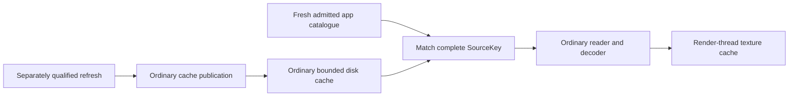

# Responsive app artwork: next product boundary

Normal interaction should read a bounded ordinary icon cache. Privileged fill
and refresh should run through a separate, explicitly admitted operation, rather
than starting a Root helper on each interactive miss. The
[0.58 integration](ordinary-artwork-cache-058.md) connects the ordinary storage
foundation to the existing worker/UI and an explicit diagnostic producer. Host
checks and matching ARM builds pass; native population and presentation remain
unqualified. Retained G2 0.57 continues to use packaged art with normal
Root artwork off.

The current installed broker admits one image per session. Historical non-first
helper intervals were 2.562–2.875 seconds; they are not complete-fetch timings or
a current benchmark. Diagnostics deliberately allow 30 seconds; the generic
runtime defaults to two. Reusing that default would be a wiring risk, not a
measured regression in normal 0.57. Removing the transition wait alone would
also expose early failure stages that intentionally retain an Unknown Ticket.
It would neither fix cold-icon cost nor establish safe observer/window teardown.

## Preserve the machinery; change when it runs

The smallest bridge persists an encoded image **only after** the existing
positive authenticated transfer, joined helper result and current-Ticket closure
have succeeded. The ordinary client owns those cache writes; no new privileged
filesystem write is needed. The existing protocol, source readback, path safety,
negative grader and quarantine remain intact. This improves the warm path;
per-icon initial fill may still be too slow.

A fixed bounded bulk exporter is the likely product producer if measurements
confirm that cost. It can amortize catalogue/setup work, but needs its own
source selection, publication, closure and native qualification. It does not
inherit the operator profile's five-image allowance or the installed profile's
one-image result. Packaged art and the ordinary UI remain usable during scoped
preparation; a long blocking first-run spinner is not the intended interface.

## Consumer and publication contract

- Keep a fixed cache subtree separate from favourites and the Root pending file.
  Bound disk entries/encoded bytes independently from the existing 64-texture,
  16 MiB GPU payload estimate. Cache metadata and same-UID image writes grant
  no Root authority or ability to choose a Root path/command.
- Bind entries to the complete SourceKey, encoded digest/length, observed source
  identity and producer/schema version. Match the fresh admitted catalogue before
  display. Failed catalogue reads withdraw dynamic bindings; removal, version or
  icon-path changes invalidate old and late worker results. Same-key on-disk
  mutation requires declared refresh/staleness behavior, not a continuous-freshness
  claim.
- Reuse bounded no-follow reads, cap-before-allocation input, decoder limits,
  one outstanding ordinary job, epoch withdrawal and render-thread-only uploads.
  Available images retain their alpha/aspect on OLED black. Keep the existing
  warming/known-missing distinction and initials fallback behavior.
- Do not repoint a live anchored reader by changing a manifest. Publish immutable
  leaves under a stable held root, or construct and safely retire/join a new
  reader/controller for each adopted generation.
- An uncertain privileged refresh keeps its barrier and publishes no partially
  admitted generation. Ordinary cache reads neither clear an old Ticket nor
  pretend it is Ready. Separating that refresh from unrelated normal interaction
  is an explicit integration policy, not a relaxation of the broker grader.

## Next evidence

The [ordinary held-window scene prerequisite](native-surface-scene-g2.md) now
passes against retained G2 0.57, with full cleanup and independent saved replay.
It informs departure/teardown behavior for an active privileged refresh without
qualifying that refresh. A prefilled ordinary cache needs no Root session merely
to render.

The ordinary worker, independently fresh catalogue and explicit diagnostic
producer are now connected in 0.58. Its normal consumer loads a fixed independently
packaged producer association on the existing image worker; a cache miss does
not dispatch privileged work. Matching executable/positive-transfer qualification
remains a prerequisite to native cache population. Native acceptance must establish normal
Home/Apps/keyboard/owned-app behavior with **zero Root dispatch on cache hits**,
SourceKey invalidation, stale-result discard and joined texture shutdown.
Measure cold refresh separately before selecting a bulk-producer scope and
budget. Early-stage Unknown handling, privileged refresh concurrency, broad app
coverage and performance remain open. This plan adds no Home, boot, jail,
network, media or OLED changes.

Luma owns this cache, source association and composition. Rendering, input and
the bounded image decoder continue to build on the explicitly attributed
PlxNative framework. Plex client/player/account features remain outside Luma.
