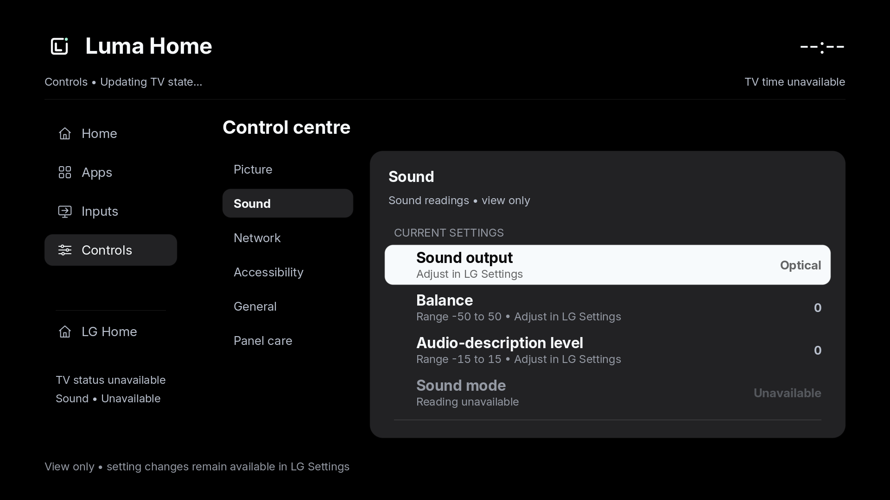
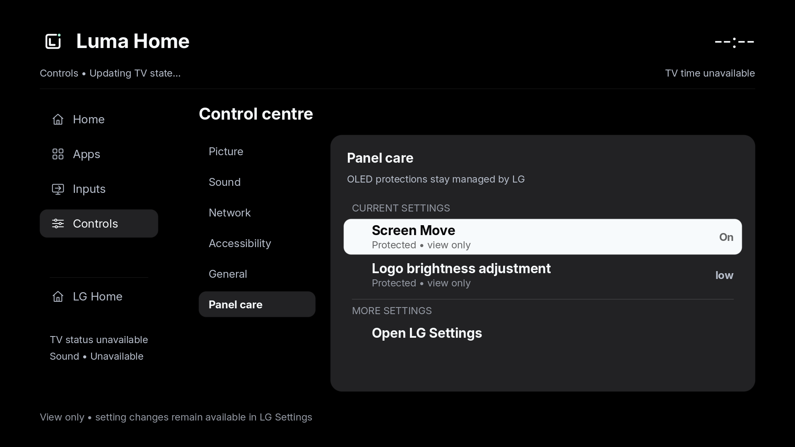

# Control-row presentation preview

These are host-rendered synthetic fixtures from the 0.27.0 candidate, using
Luma's real shared form and rendering paths. They contain no TV inventory or
household captures. They do not establish native TV rendering, current device
values or deployment. At capture time G2 retained 0.26.0 and C2 retained 0.20.0;
the later [G2 0.28.0 delivery](../../apps-scroll-rest-milestone.json) has its own evidence.

The [fixture](snapshot.json) exercises current readings without optional
descriptors, signed ranges, unavailable/context-mismatched values, and protected
panel/startup controls. The host run captured ten pages with zero reported GL
errors; four changed panels were visually reviewed. The normal setter admission,
disabled bindings, numeric editor and LG route actions are unchanged.

The [Picture](picture.png) and [General](general.png) panels exercise the same
wording and value rules. [Verification metadata](verification.json) pins the
fixture, images and built binaries. Checks include 186 library tests, host
clippy with warnings denied, a host renderer build and an ARM release build.

To reproduce, build `home-preview` with `build-client.py host --bin home-preview`.
Create a fresh private assets directory containing this `snapshot.json`, the
three files from `resources/fonts/`, and `assets/luma-home/icon-160.png` renamed
to `icon.png`. Set `PLXNATIVE_APP_DIR` to that directory and
`PLXNATIVE_RUNTIME_DIR` to a separate fresh directory. Run the host binary with
the assets directory and a new capture-directory path as its two arguments.
It generates the page PPMs and `shell-receipt.json`; convert PPMs to PNG for
viewing. Use fresh directories so prior runtime or preference state cannot
influence the fixture.
