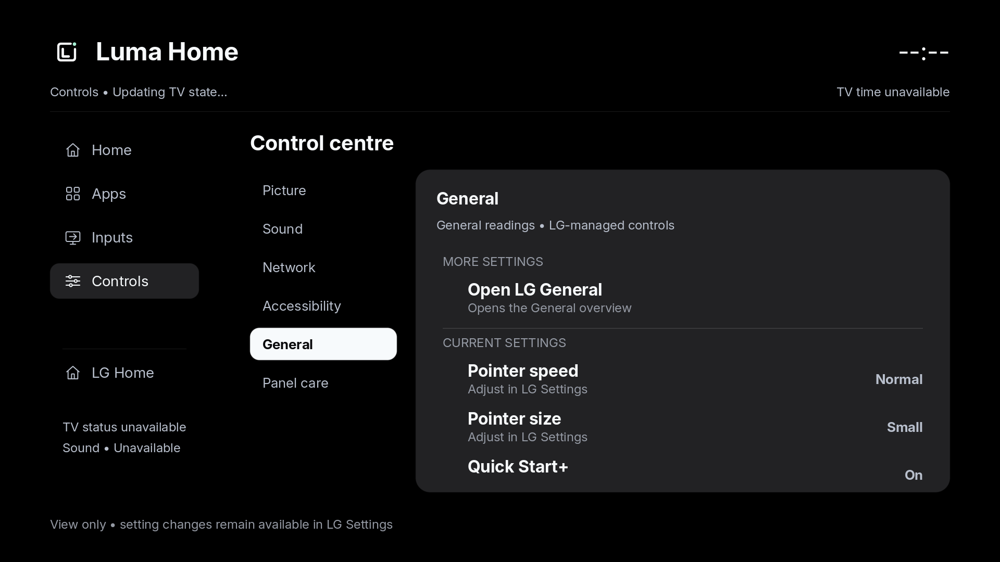

# Controls access: synthetic 0.61 preview

These images use the actual host renderer and the existing public
[synthetic fixture](../control-row-presentation/snapshot.json). They contain no
TV inventory or household data and are not TV screenshots. They illustrate the
LG shortcut appearing before native readings; fixture values are illustrative.

[Picture](picture.png) and [Network](network.png) use the same shared form. The
scripted six-category navigation, independent detail focus, Back hierarchy and
unchanged preferences pass. No setting or app-launch action ran. The session
icon ledger is correctly absent from this host capture. The
[milestone](../../controls-and-icon-observations-061-milestone.json) binds the
source, fixture, renderer executable, receipt and image hashes.
