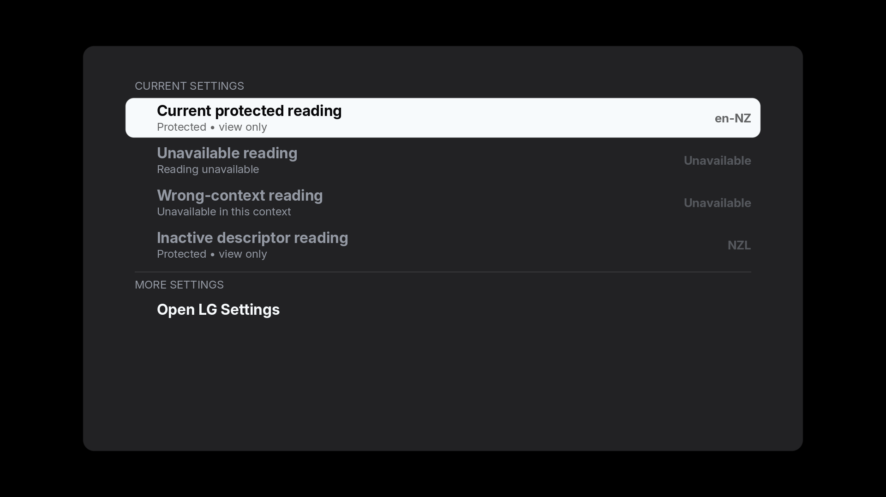
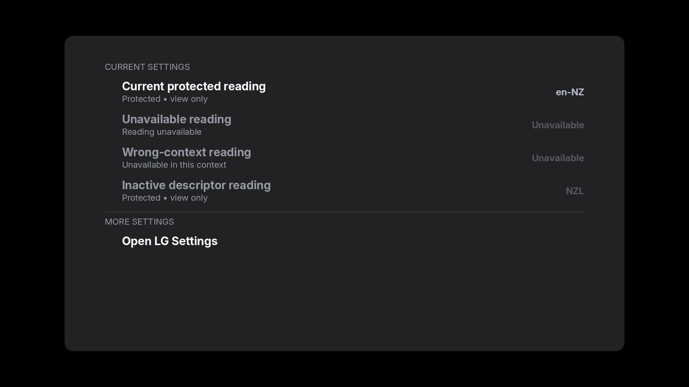
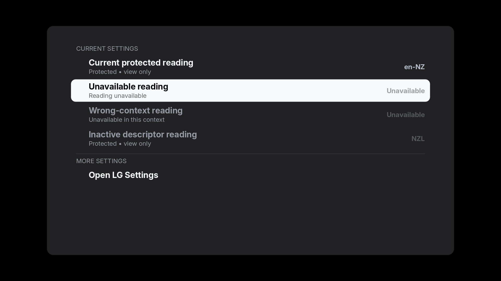

# Current read-only value contrast

The 0.31.0 candidate separates activation blocking from dim styling. A current
protected reading keeps the normal value ink and its “Protected • view only”
description. It cannot activate or open an editor. Unavailable, wrong-context and
inactive protected readings keep their previous dim styling. The verified native
Pointer speed editor and LG-managed route admission are unchanged.

The explicitly attributed PlxNative integration patch adds the generic
`FormSection::read_only` binding; Luma's model supplies the reading/descriptor
policy. The existing `disabled` API retains its old dimming behaviour.

These three frames come from the actual shared FormTable desktop renderer with
synthetic values. They contain no TV inventory or household data. The host-only
example rejects ARM compilation and has no TV transport or action executor.







Repeated glyph-interior clusters against paired local backgrounds measure
5.66:1 for the current focused value and 8.59:1 unfocused. The intentionally dim
unavailable focused value remains 2.56:1. Current values clear our 4.5:1 design
target; this is neither a compliance assessment nor a calibrated panel reading.
Antialiased edge pixels are excluded. The [summary](summary.json) records image
and private audit hashes. Root inspected all three native renders.

Checks passed: 208 application library tests, 5 home-preview binary tests, the
new upstream-form regression, 13 framework-verifier fixture tests, 14 provenance
and entrypoint tests, all-target host clippy with warnings denied, and ARM release
compilation. The ARM build retains its existing unstable `neon` target-feature
warning. A meaningful RED/GREEN model regression first demonstrated the old
current-value dimming. The pixel audit passed 85 assertions; that count is not
physical, TV compatibility or release coverage.

Reproduce the host frames with the prepared framework and its shipped fonts:

```sh
PLXNATIVE_APP_DIR="$PWD/.dependencies/plx-native/pkg" \
  cargo +nightly-2026-07-02 run --locked --features hostsim \
  --example read_only_contrast -- /absolute/previously-absent/output-directory
```

The [build-input record](../../build-inputs.md) explains the restored dependency
pins, new per-build/package checks and historical formatting caveat. This host
record does not establish a G2 normal update or full dashboard release.

## Isolated G2 qualification

The subsequent [0.31.0 native record](../../read-only-values-031-milestone.json)
checks five General language/region values under an ordinary app UID on webOS24.
All five focused values and return-up measure 5.66:1 in the native PPM captures,
versus 2.56:1 in the corresponding frozen 0.30 captures. Labels and details retain
their previous colour families. Root inspected seven frames, including the
LG-managed route without activating it; Luma branding, black canvas and focused
row visibility remain intact. The native row observer has no `dim` field: raster
evidence establishes appearance, and binding metadata establishes disabled state.

The bounded read/layout run passed all 24 preservation/removal checks and removed
its separate Proof package. Retained normal G2 stayed 0.30.0 during that run, with appinfo,
executable and favourites bytes/owners/modes preserved. LG Home and checked core,
settings, input, audio and locale state are unchanged. An independent saved audit
passed 533 assertions, with a byte-identical second replay; six raw process files
bind the actual UID, start time and executable. The separate pixel audit passed
174 assertions. Raw household frames and values remain private.

This is an isolated G2 read/layout and captured-contrast result. No normal update,
C2 contact, physical input, freshness-transition, calibrated panel or full-release
claim follows. The historical dependency-input caveat for 0.30 remains explicit.
The later [backed-up normal 0.31.0 delivery](../../retained-preview-031-milestone.json)
separately verified normal operation and preserved favourites; its evidence is
distinct from this isolated contrast check.
